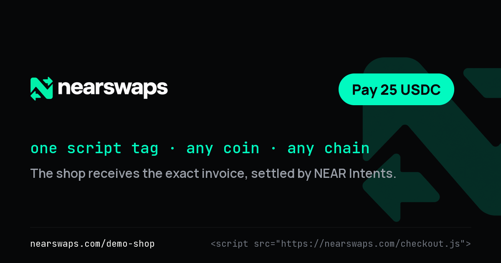
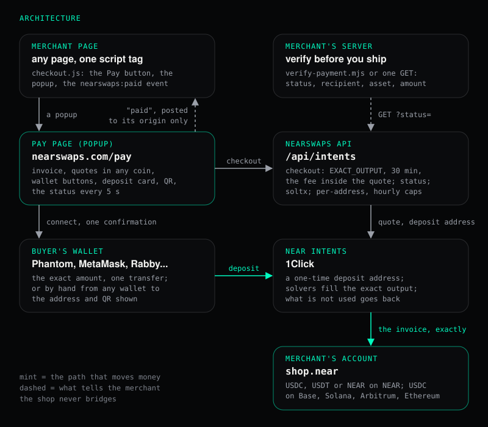

<p align="center"></p>

# nearswaps checkout

Accept a payment from any wallet on any chain with one script tag.

The buyer pays with the coin and chain they already hold: SOL, ETH, BTC, ZEC, USDC or USDT on their chains, or NEAR.
NEAR Intents (1Click) settles it, and the merchant receives exactly the invoiced amount in the asset and on the chain
they chose. No merchant account, no bridge, no SDK: a button, a pay page at nearswaps.com/pay, and one public status
call that proves the payment.

## The one tag

```html
<script src="https://nearswaps.com/checkout.js"
        data-to="shop.near" data-amount="25" data-asset="usdc" data-label="Order 1042"></script>
```

That draws a "Pay 25 USDC" button where the tag sits. A click opens `https://nearswaps.com/pay` in a popup (a new tab
on phones). No iframe and no stylesheet on your page: the button carries its own inline styles.

| Option | Meaning |
|---|---|
| `data-to` | who is paid: a NEAR account, or an address on the chain of `data-asset` (required) |
| `data-amount` | the invoiced amount, e.g. `25` or `12.50` (required) |
| `data-asset` | `usdc` (USDC on NEAR, the default), `usdt`, `near`, `usdc-base`, `usdc-sol`, `usdc-arb`, `usdc-eth` |
| `data-label` | shown on the invoice, at most 80 characters |
| `data-theme` | `light` for light pages |
| `data-onpaid` | the name of a function on `window` to call when the pay page reports the payment |

From code: `NearswapsCheckout.open({ to, amount, asset, label })`.

When the pay page sees the payment delivered, your page gets a `nearswaps:paid` event (it bubbles to `document`):

```js
document.addEventListener("nearswaps:paid", (e) => {
  // e.detail: { depositAddress, amount, asset, label, to, statusUrl }
});
```

The event is a convenience. [The status call is the proof](#verify-before-you-ship).

## Try it in two minutes

No wallet and no money needed to see it work.

1. Open **[nearswaps.com/demo-shop](https://nearswaps.com/demo-shop)**. Three products (1, 2 and 5 USDC) with the real
   tag, paying `tome.near`. The page says plainly that its buttons take real money.
2. Press **Pay** on any of them. The pay page opens in a popup with the invoice: who is paid, the amount, the label,
   and the shop's origin once the browser vouches for it.
3. Pick a coin in the "Pay with" list. Each row shows a dry quote: what you would send for this invoice, with the fee
   included. Seen on the live pay page on 11 Nov 2026 for a 1 USDC invoice:

   | Pay with | You send about |
   |---|---|
   | ETH | 0.000494 ETH |
   | SOL | 0.012131 SOL |
   | USDC on Ethereum | 1.015197 USDC |
   | USDC on Solana | 1.015198 USDC |
   | NEAR | 0.279117 NEAR |

   That day the Base and Arbitrum routes answered "Quoting for this pair is not available" from 1Click, and the pay
   page showed that line in their rows. Quotes move with prices; the shape does not. The amount carries a 1% buffer
   that 1Click sends back when the route does not use it (see the first payment below).
4. To see a deposit address, enter a refund address of your own on that chain (with a wallet in the browser, choose
   "Pay by hand instead" first) and press "Get the address". You get a one-time address, the exact amount, a QR code and a 30-minute deadline. Nothing moves
   until you send, and an address nobody pays simply expires.

Locally, with nothing real at all: `npm run serve`, then open http://127.0.0.1:8788/demo-shop. The local server points
the same shop at a local pay page and a mocked backend, so every quote, address and payment there is made up. Add
`&wallets=mock` to a pay link (or start it with `--mock-wallets`) for a mocked Phantom and MetaMask that ask with the
browser's confirm box.

## Pay from a wallet

With a browser wallet on Solana, Ethereum, Base or Arbitrum, paying is one click and one confirmation. The pay page
finds the wallets in the browser (Wallet Standard and EIP-6963): Phantom, Solflare, MetaMask, Rabby, Backpack, Coinbase
Wallet, OKX Wallet and others. After you pick a coin it shows a row of buttons, "Pay with Phantom", "Pay with
MetaMask" and so on.

A wallet button:

1. connects and reads your address, which becomes the refund address ("refunds go to ..." under the button);
2. asks for the live quote and draws the deposit card (amount, address, QR, deadline), which stays as the fallback;
3. asks the wallet for one transfer: exactly the quoted amount to the quote's deposit address. On EVM chains that is
   an ETH value or an ERC-20 `transfer`, after switching the wallet to the right network. On Solana the server builds
   the unsigned transfer and the pay page reads it byte by byte before the wallet sees it ([SECURITY.md](SECURITY.md));
4. on success the status starts at "Deposit seen", with the transaction linked on Solscan, Etherscan, Basescan or
   Arbiscan.

Cancelled or failed in the wallet, the deposit card stays: "You cancelled in Phantom, so nothing was sent", with
"Try again" to the same deposit address. A live quote older than 60 seconds is never sent from a wallet; the page asks
again first.

Bitcoin, Zcash and Tron are paid by hand: the pay page shows the address, the exact amount, a QR code and an "Open in
wallet" link where the chain has one (`bitcoin:`, `ethereum:`, `solana:`), and follows the deposit. Paying from NEAR
(NEAR, USDC or USDT on NEAR) connects a NEAR wallet and sends in one transaction.

## Accept a real payment

The first real payment through the checkout, made on 11 Nov 2026 at about 11:00 UTC: 2 USDC to `tome.near` for
"Demo shop: coffee" on nearswaps.com/demo-shop, paid from Solana with USDC.

- Deposit address: `2C8zc62gRcd7g3PsbvptBpxqYLmpctuxyAKcs8yvE1EB`
- Status: `SUCCESS`, updated 2026-11-11T11:02:56Z
- Delivered: 2 USDC (`2000000`) on NEAR to `tome.near`, exactly the invoice
- Payout on NEAR: [GvHFEnPF2CuXzuvEozrbFUWrXeCXwZiy9ZzAp25FcMga](https://nearblocks.io/txns/GvHFEnPF2CuXzuvEozrbFUWrXeCXwZiy9ZzAp25FcMga) (`intents.near`, `execute_intents`)
- Returned to the buyer: 0.0103 USDC on Solana, the unused part of the quote's buffer
  ([31CYDg9YSh6BPUz5fer8XEqqh7qF8WjvmGYsJacncs9PgSZR1oDwYn2wmKWWYs9UdwzxVEmTtAQq9MRjMDFuc1eh](https://solscan.io/tx/31CYDg9YSh6BPUz5fer8XEqqh7qF8WjvmGYsJacncs9PgSZR1oDwYn2wmKWWYs9UdwzxVEmTtAQq9MRjMDFuc1eh))

The status answer, as the API gave it, is [docs/runs/01-first-payment-status.json](docs/runs/01-first-payment-status.json).
The verifier against the live API:

```bash
node verify-payment.mjs 2C8zc62gRcd7g3PsbvptBpxqYLmpctuxyAKcs8yvE1EB --to tome.near --amount 2 --asset usdc
```

```text
info  deposit address: 2C8zc62gRcd7g3PsbvptBpxqYLmpctuxyAKcs8yvE1EB
info  status call: GET https://nearswaps.com/api/intents?status=2C8zc62gRcd7g3PsbvptBpxqYLmpctuxyAKcs8yvE1EB
ok    status: SUCCESS (delivered)
ok    kind: checkout
ok    quote type: EXACT_OUTPUT
ok    recipient: tome.near
ok    destination asset: USDC on NEAR nep141:17208628f84f5d6ad33f0da3bbbeb27ffcb398eac501a31bd6ad2011e36133a1
ok    invoiced: 2 USDC (2000000)
ok    delivered: 2 USDC (2000000)
info  label: "Demo shop: coffee"
info  refunded to the buyer: 0.0103
info  payout transaction: GvHFEnPF2CuXzuvEozrbFUWrXeCXwZiy9ZzAp25FcMga
info  payout transaction: 31CYDg9YSh6BPUz5fer8XEqqh7qF8WjvmGYsJacncs9PgSZR1oDwYn2wmKWWYs9UdwzxVEmTtAQq9MRjMDFuc1eh
info  updated: 2026-11-11T11:02:56.000Z
PAID: 2 USDC delivered to tome.near
```

Exit code 0. The run is saved in [docs/runs/01-first-payment-verify.txt](docs/runs/01-first-payment-verify.txt). (The
verifier prints every hash 1Click lists for the destination side; the second one is the 0.0103 USDC sent back on
Solana.) That payment was made by hand: refund address typed in, amount and deposit address pasted into the wallet.
It took long enough that the next thing built was paying from the wallet in the browser.

The second real payment, on 11 Nov 2026 at about 12:30 UTC: 1 USDC to `tome.near`, paid with one click from Phantom
(USDC on Solana) on a draft of the pay page with the wallet buttons. The page showed "Deposit seen", then "Delivered".

- Deposit address: `<<SECOND PAYMENT DEPOSIT ADDRESS: Tome to supply>>`
- Check it yourself: `node verify-payment.mjs <<SECOND PAYMENT DEPOSIT ADDRESS>> --to tome.near --amount 1 --asset usdc`

To take a real payment yourself, put the tag on your page with your own `data-to`, open it over http or https (a page
opened from disk has no origin, so the pay page cannot send it the "paid" message), pay a small invoice from another
chain, and run the verifier against the deposit address the event gives you.

## Verify before you ship

**The `nearswaps:paid` event is a convenience. The status call is the proof.** Before you ship anything, ask from
your server:

```
GET https://nearswaps.com/api/intents?status=<depositAddress>
```

It is public and read-only. Check all of these against your order:

- `status` is `SUCCESS` (delivered);
- `kind` is `checkout` and `swapType` is `EXACT_OUTPUT` (a checkout quoted through nearswaps, with your amount fixed);
- `recipient` is your address, `destinationAsset` your asset and `amount` your invoice;
- `swapDetails.amountOut` is at least `amount`.

Accept each deposit address for one order only, and record it against that order.

Or, with Node 18 or later and no packages:

```bash
node verify-payment.mjs <depositAddress> --to shop.near --amount 25 --asset usdc
```

It prints one fact per line and exits 0 when paid, 1 otherwise (not paid yet, refunded, not yours, or the call
failed). `--label "Order 1042"` checks the label too; `--api <url>` points it at another copy of the API (the local one
is `http://127.0.0.1:8787/api`). The full merchant guide is `web/docs/accept-payments.html`, on the site at
[nearswaps.com/learn/accept-payments.html](https://nearswaps.com/learn/accept-payments.html). The request and response
shapes are in [docs/api.md](docs/api.md).

## What NEAR does here

- **NEAR Intents settles across chains.** The buyer's deposit lands at a one-time address that 1Click opens for this
  invoice. Solvers on NEAR Intents fill it: they deliver the merchant's asset on the merchant's chain and take the
  buyer's coin. In the first payment, USDC sent on Solana arrived as USDC on NEAR through `intents.near`.
- **The merchant never bridges.** The quote is EXACT_OUTPUT: the merchant's amount is the fixed side and the buyer's
  amount carries the price, the route and the fee. Whatever the buyer paid with, the merchant receives the invoice in
  the one asset they asked for, on the chain they asked for, with nothing to convert.
- **The fee is inside the quote.** nearswaps' fee is 0.5%, set as the app fee on the 1Click quote, so the buyer's
  amount includes it and the merchant receives the full invoiced amount. The pay page checks with 1Click directly
  that the fees on a quote are at most 1% in total before it shows the address.
- **Refunds are 1Click's.** A deposit that misses the deadline or cannot be filled goes back to the buyer's refund
  address on the chain it came from; the unused part of the quote's 1% buffer goes back too.

## How a payment works

1. The button opens `/pay?to=&amount=&asset=&label=&ref=<your page's origin>`.
2. The pay page shows the invoice and a "Pay with" list: BTC, ETH, SOL, ZEC, USDC and USDT on their chains, plus
   NEAR, USDC and USDT on NEAR, each with a dry quote.
3. The buyer pays from a wallet in the browser ([one click](#pay-from-a-wallet)), or enters a refund address on the
   chain they pay from and gets a one-time deposit address from 1Click, with the exact amount, a QR code, an "Open in
   wallet" link where the chain has one, and a 30-minute deadline. The page checks the address with 1Click directly
   before showing it.
4. The page follows the deposit every 5 seconds (waiting, seen, processing, delivered, or refunded or failed). It
   survives a reload for 24 hours.
5. Delivered: a receipt with the payout transaction, and the "paid" message to your page, posted to your origin only.

<p align="center"></p>

## What it does not do (v1)

No refunds beyond 1Click's own, no partial payments, no fiat, no webhook (the status endpoint is the webhook), no
merchant accounts: any address can receive. That last one means anyone can make a pay link to any address, so the pay
page shows the recipient and the requesting origin in full, never a logo, and the docs tell buyers to check that the
address matches the shop. At most 5,000 USD per payment, at 1Click's price; the smallest payment is 1Click's minimum
for the route (in dry quotes on 9 Nov 2026, 0.1 to 0.15 USDC on most routes and about 6.21 USDC from Bitcoin; see
[docs/api.md](docs/api.md)).

## This repository

| Path | What |
|---|---|
| `web/pay.html`, `web/assets/pay.js`, `web/assets/pay.css` | the pay page served at nearswaps.com/pay, with the wallet code (EIP-6963, Wallet Standard, the Solana transfer check) ported from the nearswaps swap page |
| `web/assets/vendor/qr.js` | the QR encoder: the MIT `qrcode` package's core and `dijkstrajs`, bundled unchanged by `tools/build-qr.mjs` (licences in `qr-LICENSE.txt`). **On nearswaps.com it is `/assets/pay-qr.js`** (with `pay-qr-LICENSE.txt`): the site's `assets/vendor/` folder holds only its own core files, so the sync copies the encoder under that name and points the synced `pay.js` at it |
| `web/checkout.js` | the loader merchants add |
| `web/docs/accept-payments.html` | the merchant docs page, in the nearswaps learn-page style, as the local server shows it. **On nearswaps.com it is `/learn/accept-payments.html`**, which the site generates from its own content file (the sync never overwrites that copy) |
| `demo/shop.html`, `demo/assets/demo-shop.js` | the demo shop: three products, the real tag, a "Paid" banner from the `nearswaps:paid` event. On nearswaps.com: `/demo-shop` and `/assets/demo-shop.js` (a file, because the site's Content-Security-Policy runs no inline script) |
| `verify-payment.mjs` | the payment verifier: Node 18 or later, no packages, exit code 0 when paid |
| `docs/api.md` | the backend contract: the `checkout` and `status` request and response shapes |
| `docs/runs/` | the first real payment: its status answer and the verifier's output |
| `docs/hero.png`, `docs/architecture.svg` | the images above; `python docs/build-hero.py` rebuilds the hero from `docs/brand/` (Manrope and JetBrains Mono under the SIL Open Font License, licences beside them) |
| `tests/fixtures/status/` | status answers in the shape of the backend contract (pending, success, refunded, wrong recipient, short amount) for the verifier's tests; the real one is in `docs/runs/` |
| `tools/serve-local.mjs` | a local copy with a mocked backend: `npm run serve`, then the pay page at http://127.0.0.1:8787/pay?to=shop.near&amount=25, a test shop at http://127.0.0.1:8788/ and the demo shop at http://127.0.0.1:8788/demo-shop. `&wallets=mock` (or `--mock-wallets`) adds a mocked Phantom and MetaMask; `--site <path to the nearswaps site folder>` serves the site's fonts and colours too |
| `tools/mock-soltx.mjs` | the unsigned Solana transfer the mock's `soltx` answers, in the site builder's layout (the tests check it rebuilds `tests/fixtures/soltx.json`, made by the site's own builder, byte for byte) |
| `tools/sync-to-site.mjs` | copies into the nearswaps site folder: `pay.html`, `assets/pay.js`, `assets/pay.css`, `assets/pay-qr.js` and `assets/pay-qr-LICENSE.txt`, `checkout.js`, `learn/accept-payments.html`, `demo-shop.html` and `assets/demo-shop.js`, and the `/pay` and `/demo-shop` lines in `_redirects`; nothing else, never into `assets/vendor/`, and never an HTML file with an inline script |
| `tests/` | `npm test` (Node, no packages); `tests/browser` (Playwright at 1440 and 390 px, against the mock) |

The pay page uses nearswaps' shared files (brand tokens, fonts, coin icons, the NEAR wallet selector). Without them
(the local server without `--site`) it still works with fallback colours.

## Hackathon scope, libraries and how it was built

Built 7 to 11 Nov 2026 at NEAR HACKATHON, tracks **Real-World Money** and **Open Innovation**. Every commit in this
repository was made in the hackathon window (first commit 9 Nov 2026); the tag `hackathon-submission` marks the
submitted state. The backend's `checkout` action was written for this project in the same days, in the nearswaps site's
own backend, which is not in this repository; its contract is [docs/api.md](docs/api.md).

What predates the hackathon and is outside this repository: the nearswaps.com site, its NEAR Intents proxy for swaps
and bridging (quotes, deposit addresses, status, the 1Click signature check, the per-address and site-wide quote
caps), and the swap page's wallet code (EIP-6963 and Wallet Standard discovery, the EVM send, the Solana transfer
check), which the pay page ports with its checks unchanged.

Libraries: none at run time. The QR encoder is the MIT `qrcode` package's core and `dijkstrajs`, bundled into
`web/assets/vendor/qr.js` with their licences; `@playwright/test` is a dev dependency for the browser tests only. The
fonts in `docs/brand/` are Manrope and JetBrains Mono (SIL Open Font License). The hero is drawn with Pillow; the
demo video is cut with Remotion. No templates or starter kits were used.

AI-generated code: the code, tests and docs in this repository were written by Claude (Anthropic), Claude Opus 5.5 and
Claude Fable 5.1, from written specs by Tome Blazevski, who reviewed and tested the work and made every payment by
hand.

The team's other project: the **nearswaps agent kit**, https://github.com/nearswaps/nearswaps-agents, an SDK, MCP
server and CLI that let an AI agent trade on nearswaps with a key that can trade but cannot withdraw anywhere but to
its owner.

## Licence

MIT, see [LICENSE](LICENSE).

## Links

- Try it: [nearswaps.com/demo-shop](https://nearswaps.com/demo-shop)
- The pay page: [nearswaps.com/pay](https://nearswaps.com/pay)
- The merchant guide: [nearswaps.com/learn/accept-payments.html](https://nearswaps.com/learn/accept-payments.html)
- X: [@nearswaps](https://x.com/nearswaps)
- [docs/api.md](docs/api.md), [SECURITY.md](SECURITY.md), [CONTRIBUTING.md](CONTRIBUTING.md)
